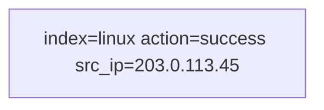

# Splunk SPL Practice · Module 1: First Shift

   

> Practice log from **Search Party**, a browser-based Splunk SPL trainer. The searches below ran against a synthetic dataset for a fictional company (Halcyon Logistics). They are written in standard SPL and can be re-run in a real Splunk instance.

## Scenario

It's your first morning in the Halcyon Logistics SOC. Rosa, your shift lead, slides a coffee across the desk: "Something hit our web servers last night. Before you can investigate anything, you need to find things. Let's start with search."

## Skills practiced

| Command | What it does | Example |
|---|---|---|
| `search` | Finds events that match words, phrases and field=value pairs. | `index=linux host=web-03 "Failed password"` |

## Searches

### 1. Open the right drawer

**Goal:** Return every event in the linux index.

```spl
index=linux
```

**Why it works:** index= is the cheapest filter in Splunk, so real searches start with it.

### 2. Find the failures

**Goal:** Return the Linux events that contain the exact phrase Failed password.

```spl
index=linux "Failed Password"
```

**Why it works:** Quoted phrases match words in order. Without quotes, Splunk would match events with 'Failed' and 'password' anywhere.

### 3. Zoom in on one server

**Goal:** Return failed logins (action=failure) on host web-03 only.

```spl
index=linux action=failure host=web-03
```

**Why it works:** Stacking field=value pairs is how you narrow a search fast and precisely.

### 4. Two suspects

**Goal:** Return Linux failed logins whose src_ip is either of those two addresses.

```spl
index=linux action=failure (src_ip=203.0.113.45 OR src_ip=45.155.205.99)
```

**Why it works:** Parentheses keep the OR from swallowing the rest of your search.

### 5. Rule out the robot

**Goal:** Return successful logins (action=success) on hosts starting with web-, excluding user=deploy.

```spl
index=linux action=success host=web-* NOT deploy
```

**Why it works:** Wildcards and NOT let you describe a whole family of events, then carve out the noise.

### 6. BOSS: The moment they got in (boss)

**Goal:** Return the successful login(s) from 203.0.113.45.

```spl
index=linux action=success src_ip=203.0.113.45
```

**Why it works:** One event changes everything: at 09:04:51 the attacker logged in as deploy. That's your first finding.

## How the boss search flows



## Findings and notes

**In your own words: what's the difference between searching a word and searching field=value?**

While you can search any word in the logs, Field=value allows you to search by a particular value in one of the fields in a particular kind of log.

**Write the search that found the attacker's successful login, and explain each part.**

```spl
index=linux action=success src_ip=203.0.113.45
```

- `index=linux` searches only the Linux server logs
- `action=success` keeps only the successful logins
- `src_ip=203.0.113.45` keeps only logins from the attacker's IP address

**What did you find? (time, account, source IP, host)**

On Nov 03 09:04:51, on server web-03, there was an sshd[4187]: Accepted password for deploy from the src_ip 203.0.113.45 (source port 49175) over SSH, a remote login.

## Evidence added to the case file

- Attacker IP: 203.0.113.45
- Logged in to web-03 as 'deploy' at 09:04:51

## Next steps

- Re-run these searches in a real Splunk instance (for example a Splunk free trial, or a public practice dataset such as Boss of the SOC) and add screenshots.
- Continue to Module 2: Make It Readable.
