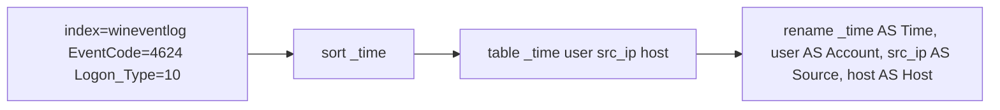

# Splunk SPL Practice · Module 2: Make It Readable

   

> Practice log from **Search Party**, a browser-based Splunk SPL trainer. The searches below ran against a synthetic dataset for a fictional company (Halcyon Logistics). They are written in standard SPL and can be re-run in a real Splunk instance.

## Scenario

Rosa reads your search results and winces. "Nobody upstairs reads raw logs. Give me tables a manager can understand in ten seconds."

## Skills practiced

| Command | What it does | Example |
|---|---|---|
| `head` | Keeps the first N results (newest first by default). | `\| head 5` |
| `table` | Shows only the fields you list, as columns, in your order. | `\| table _time user src_ip` |
| `rename` | Changes column names. Quote names with spaces. | `\| rename src_ip as "Source IP"` |
| `sort` | Orders results. A minus sign means descending. | `\| sort -count` |
| `dedup` | Removes repeats, keeping the first event for each value. | `\| dedup user` |

## Searches

### 1. A table, not a wall

**Goal:** Show Linux failed logins as a table with columns _time host user src_ip.

```spl
index=linux action=failure | table _time host user src_ip
```

**Why it works:** table is the fastest way to make events readable.

### 2. Friendly names

**Goal:** Table successful Linux logins with _time user src_ip, then rename src_ip to Source IP.

```spl
index=linux action=success | table _time user src_ip | rename src_ip AS "Source IP"
```

**Why it works:** rename changes column headers without changing the data.

### 3. Latest five

**Goal:** Show the 5 most recent failed logins on web-03 as a table of _time user src_ip.

```spl
index=linux action=failure host=web-03 | table _time user src_ip | head 5
```

**Why it works:** Results come back newest-first, so head is a quick 'latest N'.

### 4. Who's been in?

**Goal:** One row per user with a successful Linux login. Use dedup, then show just the user column.

```spl
index=linux action=success | table user | dedup user
```

**Why it works:** dedup removes repeats. Remember it keeps the first (newest) event for each value.

### 5. Alphabetical attackers

**Goal:** One row per src_ip from Linux failed logins, sorted ascending, showing only src_ip.

```spl
index=linux action=failure | table src_ip | dedup src_ip | sort src_ip
```

**Why it works:** sort without a minus sorts A to Z or smallest first.

### 6. BOSS: The handoff table (boss)

**Goal:** Windows successful logons (EventCode=4624) with Logon_Type=10 (Remote Desktop), sorted oldest first, with columns renamed to Time, Account, Source, Host (from _time, user, src_ip, host).

```spl
index=wineventlog EventCode=4624 Logon_Type=10 | sort _time | table _time user src_ip host | rename _time AS Time, user AS Account, src_ip AS Source, host AS Host
```

**Why it works:** You just built a report: filter, order, choose columns, label. That's 80% of everyday Splunk work.

## How the boss search flows



## Findings and notes

**Explain the pipe | to someone who has never used Splunk.**

The pipe takes the results from the command before it and hands them to the command after it, like an assembly line.

**Paste your boss query and describe what each pipe does.**

```spl
index=wineventlog EventCode=4624 Logon_Type=10 | sort _time | table _time user src_ip host | rename _time as Time, user as Account, src_ip as Source, host as Host
```

The first pipe takes all the windows event logs with an Event Code of 4624 (Successful Logins) and a Logon_Type of 10 (Remote Desktop logons) and sorts them by the Timestamp.

The second pipe takes these filtered and sorted Windows Event Logs and creates a table with 4 designated columns.

The third pipe renames the column names.

**When would you use dedup instead of stats? (Guess now; you'll meet stats next.)**

Dedup keeps the first (most recent) event for each value of a field, so I'd use it when I want to see one full event per user or IP. Stats counts or summarizes events by a field, so I'd use it when I need numbers, like how many logins each user had.

## Evidence added to the case file

- Remote Desktop users today: alice and kpatel (both expected)

## Next steps

- Re-run these searches in a real Splunk instance (for example a Splunk free trial, or a public practice dataset such as Boss of the SOC) and add screenshots.
- Continue to Module 3: Count Everything.
